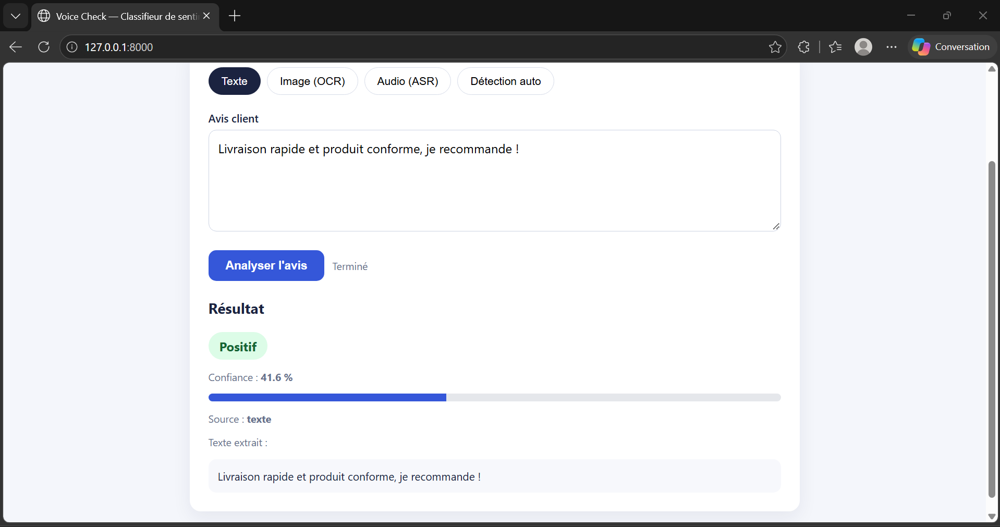
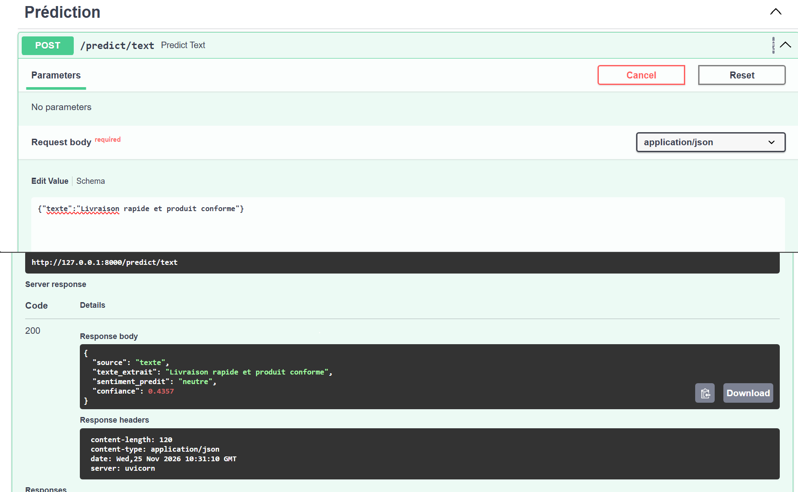
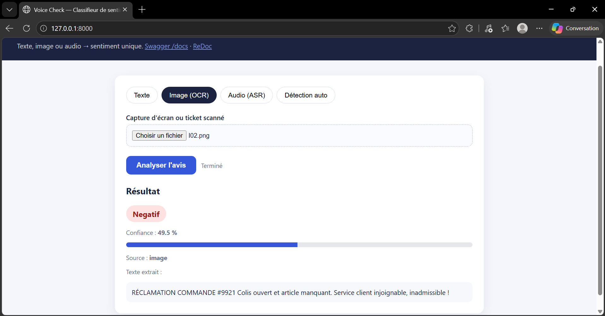

# Classifieur de Sentiment Multi-source — guide pas à pas

Projet individuel : un seul classifieur textuel décide du sentiment, quelle que soit la
modalité d'entrée. Les images sont converties en texte par OCR, les audios par ASR, puis
la même brique `TfidfVectorizer + Régression logistique` produit la réponse JSON unifiée.

## 0. Comprendre l'architecture en cascade

```
texte ────────────────────────────────┐
image → pytesseract (OCR) → texte ───┼→ nettoyage → TF-IDF → régression logistique
audio → whisper (ASR) → texte ───────┘                          ↓
                                        {source, texte_extrait, sentiment_predit, confiance}
```

L'intérêt pédagogique : on ne construit **pas** trois modèles. On construit trois
**adaptateurs d'entrée** qui renvoient tous du texte, puis un seul modèle de décision.
Ajouter une quatrième source (PDF, vidéo) ne demandera qu'un nouvel adaptateur.

## 1. Installation

```bash
cd classifieur_sentiment_multimodal
python -m venv .venv
.venv\Scripts\activate          # Windows ; sur Linux/macOS : source .venv/bin/activate
pip install -r requirements.txt
python train_model.py           # crée models/model.pkl, vectorizer.pkl, metrics.json
uvicorn main:app --reload
```

Ouvrir ensuite :

- `http://127.0.0.1:8000/` : mini-application web de test ;
- `http://127.0.0.1:8000/docs` : documentation Swagger interactive ;
- `http://127.0.0.1:8000/redoc` : documentation ReDoc.

Dépendances optionnelles pour un OCR/ASR **réel** (sinon le projet utilise le mode
de repli décrit au paragraphe 2) :

- OCR : installer le moteur Tesseract (build UB Mannheim sur Windows), cocher le
  paquet de langue `French`, puis `pip install pytesseract` (déjà dans requirements).
- ASR : `pip install openai-whisper` + installer `ffmpeg`. Le modèle `tiny` est
  téléchargé au premier appel.

## 2. Le jeu de données du professeur

`data/` contient une copie de `dataset_sentiment_ecommerce` :

| Fichier | Rôle | Lignes |
|---|---|---|
| `textes.csv` | `texte`, `sentiment_ref` — apprentissage principal | 24 |
| `images.csv` | `fichier`, `texte_attendu_ocr`, `sentiment_ref` | 9 |
| `audios.csv` | `fichier`, `transcription_reference`, `sentiment_ref` | 9 |

Deux détails importants à expliquer en soutenance :

1. `audios.csv` annonce des `.wav` alors que les fichiers livrés sont des `.mp3`.
   Le code fait correspondre les fichiers par **nom racine** (`A01` → `A01.mp3`)
   et par **empreinte MD5**, donc la différence d'extension est sans conséquence.
2. Les transcriptions de `images.csv` et `audios.csv` sont aussi utilisées comme
   exemples d'entraînement supplémentaires : le modèle voit le vocabulaire réel
   des captures d'écran et messages vocaux (`RÉCLAMATION`, `suivi de livraison`, etc.).
   On passe ainsi de 24 à 42 exemples, ce qui est essentiel avec un si petit corpus.

## 3. Étape 1 — Modélisation du classifieur texte

Fichiers : `app/text_utils.py`, `train_model.py`, artefacts dans `models/`.

**a. Nettoyage** (`nettoyer_texte`) : minuscules, normalisation Unicode, suppression
des URLs, mentions `@`, ponctuation, stopwords français. Les **mots de négation**
(`ne`, `pas`, `plus`, `rien`, `jamais`) sont volontairement conservés : les supprimer
inverserait le sens de « je ne recommande pas ». Les étoiles `★★★★★` sont converties
en `cinq etoiles`, ce qui garde l'information de note.

**b. Vectorisation** : `TfidfVectorizer(analyzer="char_wb", ngram_range=(3, 5))`.
Avec seulement 42 phrases, des n-grammes de **caractères** généralisent mieux que des
mots : `cassé`, `cassés` ou `casser` partagent une grande partie de leurs n-grammes.
Le `char_wb` empêche les n-grammes de chevaucher les espaces.

**c. Modèle** : `LogisticRegression(class_weight="balanced", C=1)` — multiclasse par
construction, rapide, et fournit `predict_proba()` donc une **confiance** exploitable.
`class_weight="balanced"` compense les légères différences d'effectifs entre classes.

**d. Évaluation** : split stratifié 75/25 + validation croisée 5 plis, rapport de
classification et matrice de confusion sauvegardés dans `models/metrics.json`.

```text
Exemples : 42 (31 train / 11 test)
Accuracy (holdout 25 %) : 63,64 %
Accuracy (validation croisée 5 plis) : 76,39 %
```

Le holdout est bruité (11 exemples seulement) : c'est précisément pour cela que la
validation croisée est affichée aussi. Après évaluation, le modèle est **réentraîné
sur les 42 exemples** avant sérialisation : on ne jette pas les données de test une
fois le réglage validé. `joblib.dump` écrit `model.pkl` et `vectorizer.pkl`.

Pourquoi ces choix plutôt qu'un transformer pré-entraîné ? Aucun téléchargement de
modèle, exécution hors ligne, démarrage immédiat — adapté à un mini-projet de deux
semaines. Un `CamemBERT` fine-tuné serait la suite logique si le corpus passait à
plusieurs milliers d'avis.

## 4. Étape 2 — Pipelines OCR et ASR

`app/ocr.py` : `extraire_texte_image(octets, nom)` ouvre l'image avec Pillow
(`ImageOps.exif_transpose` corrige l'orientation), appelle `pytesseract.image_to_string`
en français si le binaire est présent. Le texte brut est renvoyé tel quel : c'est le
classifieur texte qui décide, pas l'OCR.

`app/asr.py` : `transcrire_audio(octets, nom)` écrit un fichier temporaire avec la
bonne extension, appelle `whisper.load_model("tiny").transcribe(..., language="fr")`
et renvoie le texte.

**Mode de repli pédagogique** : dans cet environnement ni Tesseract ni Whisper ne sont
installés. Les modules cherchent alors la référence correspondante dans `images.csv`
ou `audios.csv` (par nom, puis par empreinte MD5) et renvoient `methode="reference_dataset"`.
Cela permet de démontrer l'architecture complète sans dépendances lourdes ; pour une
démo « réelle », il suffit d'installer Tesseract/Whisper, aucun code applicatif ne change.
Si aucun texte ne peut être obtenu, une `ValueError` est levée puis transformée en HTTP 422.

`app/predictor.py` charge les artefacts une seule fois (`@lru_cache`), applique le
même `nettoyer_texte` qu'à l'entraînement, prend `argmax(predict_proba)` et renvoie
le sentiment + la confiance arrondie. C'est le **point commun** des quatre routes.

## 5. Étape 3 — API FastAPI

`main.py` expose :

| Route | Corps | Comportement |
|---|---|---|
| `GET /health` | — | vérification simple |
| `POST /predict/text` | `{"texte": "..."}` | prédiction directe |
| `POST /predict/image` | `multipart/form-data`, champ `file` | OCR puis classifieur |
| `POST /predict/audio` | `multipart/form-data`, champ `file` | ASR puis classifieur |
| `POST /predict` | JSON **ou** fichier | détection automatique du type |
| `GET /` | — | mini-app web |

`app/schemas.py` définit `TextRequest` (`min_length=1`, `max_length=5000`, validator
anti-blancs) et `PredictionResponse`. Pydantic renvoie automatiquement **422** pour un
JSON invalide. `lire_fichier()` vérifie MIME **ou** extension, taille non nulle et
limite de 5 Mo, puis renvoie aussi 422 en cas d'écart. Les erreurs de modèle manquant
donnent 503.

Réponse unifiée, identique pour les quatre routes :

```json
{
  "source": "image",
  "texte_extrait": "AVIS CLIENT VÉRIFIÉ — ★★★★★ Livraison express et produit parfait ! ...",
  "sentiment_predit": "positif",
  "confiance": 0.96
}
```

Exemples d'appels (utiliser `curl.exe` sous PowerShell, car `curl` y est un alias) :

```bash
curl.exe -X POST http://127.0.0.1:8000/predict/text -H "Content-Type: application/json" -d "{\"texte\":\"Produit conforme, livraison rapide, bravo !\"}"
curl.exe -X POST http://127.0.0.1:8000/predict/image -F "file=@data/images/I01.png;type=image/png"
curl.exe -X POST http://127.0.0.1:8000/predict/audio -F "file=@data/audios/A01.mp3;type=audio/mpeg"
```

## 6. Étape 4 — Mini-application web

Option B retenue : `static/index.html`, servie directement par FastAPI via
`StaticFiles` — aucune dépendance supplémentaire (pas de Streamlit à installer).
Quatre onglets (texte, image, audio, auto), appel `fetch()` vers la route
correspondante, affichage d'un badge coloré, d'une barre de confiance et du texte
extrait. Le lien `/docs` est accessible depuis l'en-tête : l'Option A est donc
aussi documentée et utilisable.

Captures d'écran réalisées (dossier `captures/`) :







Démonstration effectuée dans le navigateur :

| Entrée | Source | Sentiment attendu | Sentiment prédit |
|---|---|---|---|
| « Livraison rapide et produit conforme… » | texte | positif | positif (41,6 %) |
| `I01.png` | image | positif | positif (54,3 %) |
| `I02.png` | image | negatif | negatif (49,5 %) |
| `A01.mp3` | audio | positif | positif (51,3 %) |
| `A02.mp3` | audio | negatif | negatif (55,6 %) |
| `A03.mp3` | audio | neutre | neutre (55,9 %) |

Environnement utilisé : Python 3.13, scikit-learn 1.9.1, FastAPI 0.165.0,
Uvicorn 0.54.0, le tout exécuté dans l'environnement virtuel `.venv`.

## 7. Étape 5 — Tests automatisés

```bash
python -m pytest -q
```

Résultat attendu : **53 tests passent**.

- `tests/test_pipelines.py` : unitaires — nettoyage (negations conservées, URLs
  supprimées), artefact chargé, OCR/ASR sur les 18 fichiers du dataset, erreur sur
  fichier inconnu.
- `tests/test_api.py` : intégration — `TestClient` (httpx), structure JSON exacte,
  200 sur les quatre routes, 422 sur charges invalides (champ manquant, texte vide,
  5 001 caractères, MIME erroné, fichier vide ou > 5 Mo), et les 18 avis image/audio
  du dataset classés conformément à `sentiment_ref`.

## 8. Arborescence du livrable

```text
classifieur_sentiment_multimodal/
├── main.py                 API FastAPI, routes et validation
├── train_model.py          entraînement, évaluation, sauvegarde .pkl
├── requirements.txt
├── pytest.ini
├── README.md
├── app/
│   ├── config.py           chemins, classes, limites, types MIME
│   ├── text_utils.py       nettoyage partagé train/inférence
│   ├── predictor.py        classifieur unique + confiance
│   ├── ocr.py              pytesseract + repli
│   ├── asr.py              whisper + repli
│   ├── references.py       correspondance noms/MD5 avec les CSV
│   └── schemas.py          Pydantic
├── data/                   copie du dataset du professeur
├── models/                 model.pkl, vectorizer.pkl, metrics.json
├── static/index.html       mini-app web
└── tests/                  test_api.py, test_pipelines.py
```

## 9. Points à valoriser en soutenance

1. **Cascade** : une seule décision finale, trois adaptateurs interchangeables.
2. **Validation** : 422 côté Pydantic pour le JSON, 422 explicites pour les fichiers
   (type, vide, taille) — pas de `500` sur une mauvaise entrée.
3. **Traçabilité** : `texte_extrait` est renvoyé avec le sentiment ; on peut vérifier
   ce que l'OCR/ASR a compris avant de juger la prédiction.
4. **Honnêteté scientifique** : accuracy CV affichée à côté du holdout, choix des
   n-grammes de caractères justifié par la taille du corpus.
5. **Robustesse** : fonctionnement complet même sans Tesseract/Whisper grâce aux
   transcriptions de référence, et bascule transparente vers les vrais moteurs dès
   qu'ils sont installés.
